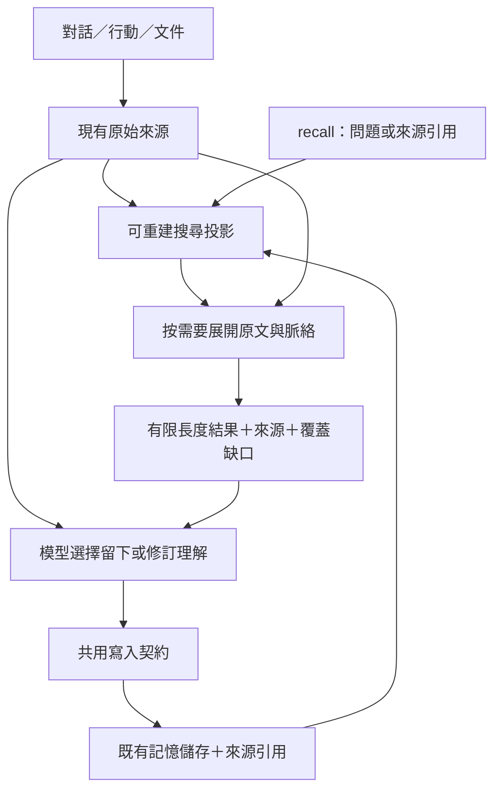

# 整合記憶系統：寫入與召回 — Epic 規格 r2

> - 日期：2026-10-28（Asia/Taipei）
> - 狀態：r2。S0 已交付並合併（[#651](https://github.com/Dakai666/Loom/pull/651)），盤點修正、S1 預算與 §1.2 裁決由 DK 確認。S1 可動工。
> - 版本：r0 由 Codex 依 DK 初步方向起草；r1 依 [#650 Loom agent review](https://github.com/Dakai666/Loom/issues/650) 與 [Claude Code review](https://github.com/Dakai666/Loom/issues/650#issuecomment-6470563466) 收斂；r2 依 S0 報告與 [S0 review](https://github.com/Dakai666/Loom/pull/651#issuecomment-6472177779) 更新（變更摘要見 §15）。
> - Epic：[#650](https://github.com/Dakai666/Loom/issues/650)，Claude Code 與 Loom agent 的共同 review／補充入口。
> - 程式核對基準：`51bb2a611a2d5b12c128084f6b46d720f8a34597`。
> - 關聯：[#643](https://github.com/Dakai666/Loom/issues/643)、#634、#635、#633；既有規格 53／56／57／58。
> - 範圍：下一階段的記憶讀寫整合；本文件不授權直接切換正式資料或重啟服務。

## 1. 方向與完成定義

DK 對下一階段的核心方向：**模型能力越強，框架得越整合、越薄。**

本 Epic 有兩條不可分割的路線：A「如何留下與更新記憶」；B「如何自然找回與接續過去」。兩條路共用來源、身分、版本與生命週期契約，每個實作切片必須交付一次可驗證的寫入到召回閉環。

完成後，Loom agent 只需表達「我想記住什麼」與「我想起什麼」，不必先理解 semantic、episodic、session log、ledger 或文件的儲存分工。沒有被抽成 fact 的經歷，也應有找回的機會。

薄框架負責：可靠保存、來源定位、索引、範圍隔離、原子更新、版本檢查與有限資源。模型負責：理解、選擇查詢、判斷意義、提出整理與修訂。不要把這些認知活動各自做成固定啟動的背景 agent、分類器或多輪模型審查管線。

本 Epic 不以「facts 變少」「recall 次數變多」「多出一張表」宣稱成功。完成必須同時證明：過去找不到的經歷能找回、新的理解能追溯與修正，以及原有重疊機制確實被收斂。

### 1.1 r1 收斂主軸與 DK 裁決

**原始經歷早已保存，缺的是可搜尋性，不是新儲存。** `session_log` 自 2026-04-03 起保存完整對話文字與工具回覆摘要（≈8.6 萬列、無 TTL；工具回覆只存前 500 字，較完整的工具輸出在 `action_records.output_prefix`，見 §1.2），但 `recall` 讀不到它；於是系統用 `compress_session` 把經歷例行轉寫成 fact 來補位——目前 semantic 約 71%（排除 stub 後約 65%）來自此路徑，agent 主動 `memorize` 約 11%。因此本 Epic 的主軸是：**讓 `session_log` 成為可搜尋的原始經歷，然後停掉為了「原文找不到」才存在的自動提煉。**

DK 已裁決（2026-10-28）：

1. **`compress_session` 在 S1 預設關閉**，不等到 S3。關閉條件：S1 固定案例全部通過。保留函式與設定開關一個版本作回復。
2. **`session_log` 明定為原始經歷的權威來源，不設 TTL。** 任何未來的清理都必須同時處理索引失效與 `log:` ref 的「來源已刪除」回報。
3. **既有 `session:` 自動壓縮 facts 不清理、不遷移。** 照常可讀，結果中標示「自動壓縮產物、來源僅到 session 粒度」；是否清理於 S4 實戰後另議。

### 1.2 r2：S0 後的 DK 裁決（2026-10-28）

S0 報告：[`61a-整合記憶系統-S0基準與盤點.md`](61a-整合記憶系統-S0基準與盤點.md)（量測數據 `61a-memory-s0-metrics.json`）。以下裁決以該報告為依據。

1. **工具原文不新增保存點。** `session_log` 的工具列只是 500 字摘要（`session.py` 的 `tool_output[:500]`），不是完整回覆。較完整的工具輸出已由 #569 保存在 `action_records.output_prefix`（上限 16,384 字，附 `output_digest`／`output_len`），可用 `session_id＋tool_call_id` 關聯（S0 實測 37,777／39,513）。S1 索引摘要並標「摘要」；`recall(ref=log:...)` 展開時從 `action_records` 補較完整原文並標截斷，無關聯者明示「僅摘要」。是否索引 `output_prefix` 待固定案例證明需要時再議。recall 對 `action_records` 唯讀，不改 prediction observation 邊界。關閉 compress 後，舊工具原文的上限即「摘要＋prefix」，不宣稱可還原全文。
2. **改述／跨語言分兩層驗收。** 單次呼叫層（S1 硬門檻）：literal 中文、兩字詞、identifier、無答案、範圍限制、去重案例一次 `recall` 必過。agent 迴圈層（另計）：改述／跨語言允許主模型以同一使用者問題自主改寫搜尋詞，最多 3 次 `recall`，記錄次數與延遲；此層結果不得宣稱為單次改善。不加 hidden LLM；迴圈層不足再附數據評估 `session_log` embedding。
3. **child 經歷先接來源再退 episodic。** subagent trace 只寫 `episodic`、不在 `session_log`。S3 停 episodic 寫入／TTL 前，先把 child trace 接到可保存、可找回的來源，並測「child 工具失敗 → 原始經歷可讀」。
4. **索引容量：新索引淨增上限 128 MiB**（`memory.db` 當時約 356 MiB）。
5. **兩字詞須有上限且隨成長有效。** 不採固定 row 數的線性掃描（以每月約 1.2 萬列的成長，100,000 rows 上限一到兩個月內即觸頂）。改用 **CJK bigram 影子索引**：user／assistant 文字的 CJK 段展開成 bigram、其餘文字原樣保留，`unicode61`、`content=''`、`detail=none`、`contentless_delete=1`；只回答「哪些回合含此詞」，片段與排序仍讀 `session_log`。副本實測（45,092 列）：4.3 MiB、建索引 1.0 秒、查詢 <1 ms，成長約每月 1 MiB，含在 128 MiB 內。單一 CJK 字查詢走限時、依事件時間（`created_at` 索引）由新到舊的分段掃描，超限明示「已查到哪個時間點，可用 `since=… until=…` 續查」，不回報不存在；掃描不依 row id，因 fork 列保留原事件時間、id 大不代表事件新。

**S1 預算（依 S0 §7，DK 確認）**：每路候選 ≤40 個獨立 ref／回合、最終預設 5 筆；`ref` 展開 ≤3 回合／128 rows／8,000 字並標截斷；初次輸出每筆 ≤512 字、整次 ≤4,000 字（含來源與覆蓋行）；工具摘要索引 512 字；暖機 recall p95 ≤700 ms（同 profile 比較，主模型追查另計）；migration 單機 rebuild ≤30 秒；額外必跑 LLM 0。字元數不冒充 token 數。

**修改前基準（S0 合成集）**：S1 Hit@5 8/24、無答案假命中 7/8（現行 lexical／fallback 與 embedding 回放兩個 profile 相同）。S1 須在相同案例與 profile 下比較。

## 2. 已核對的現況與問題

以下是程式現況；改善方案從 §4 起另列，不能把提案當成已實作能力。

| 現況 | 程式依據 | 使用後果 |
|---|---|---|
| `recall` 主要搜尋 semantic facts 與 procedural skills | `memory/search.py::MemorySearch.recall` | 未被抽成 fact 的對話、活動、文件難以被自然語言問題叫回 |
| `recall_period` 可取指定期間的多層資料，但必須先提供時間 | `memory/facade.py::recall_period` | 沒有日期線索時，agent 仍無法從問題定位那段經歷 |
| `ledger_recall` 無自然語言 query，且至少要求一個結構化篩選條件 | `platform/cli/tools.py::make_ledger_recall_tool` | 想回憶前，得先知道 session／工具／skill／時間等位置資訊 |
| ledger 可重建行動脈絡，對話原文仍需 session log 等來源 | `ledger/recall.py`、`memory/session_log.py` | 把 ledger 包進 recall，尚不足以解決跨來源搜尋與原文展開 |
| 壓縮主要生成文字 fact，來源多為 session 字串 | `session.py::compress_session` | 來源定位通常未精確到支持該理解的訊息或片段 |
| consolidation 已保留原文、歷史與 redirect | `memory/semantic.py::consolidate` | 有可沿用的基礎，應提升成可讀取的來源契約 |
| 有直接寫 semantic 的自動反思路徑，單次經歷可能產生多份表達 | `cognition/task_reflector.py`、`counter_factual.py` | 寫入治理分散，容易重複生產，而非增加獨立證據 |
| `effective_confidence` 受存取時間影響；部分 skill 成功率使用模型自評更新 | `memory/lifecycle.py`、`cognition/task_reflector.py::_persist` | 證據、熱度、自評與保留的語意耦合 |
| `recall` 的 Tier 1 embedding 有結果即 return；無命中時 Tier 3 回最近資料 | `memory/search.py::MemorySearch.recall` | BM25 被短路；無答案問題得到假命中（#643） |
| `semantic_fts` 使用預設 `unicode61` tokenizer | `memory/store.py` | 中文整句成為單一 token，中文短詞無法 lexical 命中（#643） |
| `since`／`until` 過濾 semantic `updated_at` | `memory/search.py` | 記錄／修訂時間冒充事件時間 |
| `episodic_entries` 是同一回合的第三份副本（TTL 30 天），主要讀者為 `compress_session` | `session.py`、`memory/episodic.py`、`cognition/reflection.py`、`self_reflection.py` | 原文已在 `session_log`，此表只服務提煉路徑 |

**本機資料量級（2026-10-28 唯讀查詢）**：`session_log` 85,711 列（user＋assistant 文字 ≈9.7 MB；tool 列 39,513 列為 ≤500 字摘要，`raw_json` 皆為空）；semantic 9,938 列（非 redirect 6,209、stub 3,729），`session:` 來源 7,047／4,039（全部／排除 stub）；`episodic_entries` 4,274 列。精確口徑以 S0 報告 §6 為準。

**既有 join 鍵**：`session_log` tool 列的 `metadata.tool_call_id` ＝ `action_records.call_id` ＝ ledger `payload.tool_call_id`，三者 `session_id` 相同——工具回合可驗證關聯，不需以時間戳猜配對。缺口：ledger `turn_id`（`turn_<uuid12>`）未寫入 `session_log`，純文字回合無法對到 ledger。

#643 的修正與 S1 的 recall 重寫改同一函式，**併為 S1 的第一個 PR**，不另開平行修正。

## 3. 必須服務的使用情境

1. **模糊回憶**：「上次為什麼放棄那個設計？」不提供日期、session 或工具名稱，也能找到原討論與相關行動。
2. **未被提煉的經歷**：某次嘗試沒有生成 semantic fact，仍能從保存的對話與活動找到結果；失敗與無結論也是合法的過去。
3. **文件與閱讀**：筆記保留原貌，查詢可找到對應篇章並展開；文件不必全文轉寫成 facts 才具有可發現性。
4. **修訂與時間**：以前的判斷後來改變，可辨認當時與現在；重新蒸餾的日期不冒充事件發生日期。
5. **主體延續**：agent 自己決定留下的感受、關注與關係可跨 session 接續，不以 DK 是否追問作為保留條件。
6. **誠實缺口**：來源未保存、已過期、索引未完成或範圍不允許時，能分辨「未找到」與「不存在」。

## 4. 共用契約：來源、理解與索引

### 4.1 三種責任，沿用現有儲存

| 責任 | 內容 | 權威與變動規則 |
|---|---|---|
| 原始來源 | 對話、工具回覆、活動事件、文件版本 | 由既有 session log／ledger／action records／文件承接，保留既有保存與刪除政策 |
| 留下的理解 | agent 的判斷、經驗、偏好、整理與可引用的結論 | 沿用 semantic／procedural 等既有結構；可修正，記錄支持來源與修訂關係 |
| 搜尋投影 | 原文片段、活動片段、關鍵字／embedding 等搜尋資料 | 可重建；不成為第二份權威記憶，不反向改寫來源 |

這是責任分離，不預先要求新增三套資料庫。優先拓展既有 `MemoryFacade`，來源 reader 由組裝入口注入；ledger 保持純 sink，不反向依賴 memory／cognition。不得為統一讀取先重寫整個執行事件系統。



### 4.2 穩定引用與版本

- 結果有穩定、可解析的 `ref`。它識別目前 agent／instance 範圍內的來源或記憶；不是讓模型拼接任意檔案路徑或 SQL。
- 來源引用須能指出記錄與適用版本／片段。沿用已有 id、turn id、digest、value hash；確實不足才擴充 schema。
- 引用格式由第一個切片定案；不能只拿相同時間戳推測 session log 與 ledger 一定是一對一關係。缺少可驗證關聯時，回報近似定位或未知。
- 新的自動提煉內容必須附可解析的輸入來源；模型指定的引用只能指向實際提供的來源集合。自陳或主動創作可直接留下，須表達其性質，不能偽造外部支持。
- 來源內容已變更，展開時必須辨認版本；無法讀取舊版時，明示目前只剩哪一版。索引中的片段不能被誤報為仍可取回的完整原文。
- 來源引用不代表來源永久保存。過期／刪除／撤銷可讀範圍時，索引須移除或失效；已留下的理解可以存在，但須顯示來源不可用。
- 同一來源衍生出的多份摘要，共享根來源；不因改述次數變成多份獨立證據。

**r1 定案的 ref 格式**（不新增表，皆指向既有主鍵）：

| ref | 指向 | 版本／失效 |
|---|---|---|
| `log:{session_id}:{turn_index}` | 一個回合的 `session_log` 列；展開給該回合＋前後各一回合（有上限） | append-only，內容不變；session 被刪 → 明示「來源已刪除」 |
| `mem:{key}` | semantic entry（key 已 UNIQUE） | 附 value 短 hash；展開時 hash 不同 → 明示「已修訂，以下為現版」；沿用 consolidation redirect |
| `skill:{name}` | skill genome | 附 version |
| `doc:{collection}/{path}#{chunk}@{digest}` | 文件篇章 | S2 定案 |

S1 PR-B 定案的顯示形式：結果顯示 `mem:{key}@{sha256(value) 前 8 碼}`、`skill:{name}@v{version}`；版本後綴只在顯示與展開時使用，結果本身的身分（RRF 合併與案例評估的鍵）仍是不帶後綴的 `mem:{key}`／`skill:{name}`。展開時不帶後綴的 ref 也接受，此時不做版本比對。

- 行動脈絡不另設 `act:` ref：`log:` 回合內的 tool 列已帶 `tool_call_id`，展開時 join `action_records` 取 `final_state`／`intent_summary`，必要時唯讀查 ledger。
- 前進補強：`_log_message` 的 metadata 寫入 `ledger_turn_id`（無 schema 變更）。舊資料只有工具回合能對到 ledger；純文字回合標「無 ledger 關聯」，不猜。
- `session_log` 不可變，不需要「適用版本／片段」欄位；版本只對 `mem:` 與 `doc:` 有意義。
- `recall(ref=...)` 是 identity 讀取，不跑模糊搜尋；讀到新版、舊版不可用或長度截斷都要明示。
- S1 PR-B 實作細節：
  - `log:` 展開以目標回合為準，加上同一 session 中最近的前一個與後一個**實際存在的**回合（不是 turn_index ±1）。
  - 列數上限 128 列，依「目標回合 → 前一回合 → 後一回合」的順序分配。
  - 字數上限 8,000 字，每個鄰近回合預留 1,200 字，避免工具輸出很多的目標回合把前後回合擠成只剩標題。單列上限：目標回合 2,500 字、鄰近回合 600 字。
  - 每一處截斷都要註明是哪個回合、顯示了幾列中的幾列。
  - tool 列以 `session_id＋tool_call_id` join `action_records`，顯示 `final_state`、`intent_summary` 與 `output_prefix`；擷取時就已截斷的，標「stored output: first N of M chars」。對不到的列標「stored preview only」。
  - 列數同樣替每個鄰近回合預留 16 列（live 有 250–800+ 列的回合）；某回合一列都沒顯示時，標題只寫「N rows, none shown」，不對沒讀過的列下 ledger 等斷言。標題依實際存在的鄰近回合描述（只有前一回合、只有後一回合或唯一回合）。
  - 動作紀錄存在但沒有輸出擷取（#569 之前的資料，`output_prefix` 為 NULL）時，回退到 `session_log` 的摘要，標「stored preview only — no captured output」。
  - ref 讀不到時工具回 `success=False`（#655：success 表示讀到了結果，而不只是呼叫有跑完）。`mem:`／`skill:` 展開也套讀取時的秘密遮罩。
  - session 在 `session_log` 已無任何列時，回報「已刪除，或不屬於此 instance」；回合不存在時，回報該 session 實際的回合範圍。
  - 回合標題顯示 `ledger_turn_id`；沒有時明示「no ledger link recorded」。
  - 工具層：`ref` 與 `query` 同時給 → 拒絕；其他填了的篩選欄位不適用於 ref，會在輸出中列為「ignored with ref」而不是報錯（模型習慣填滿選填欄位，見 §6.1）。`recall` 標 `inline_only`，輸出不被 JIT 轉存到 scratchpad。

### 4.3 範圍與時間

- 預設只讀當前 agent／instance 已授權的儲存與文件集合；既有共用路徑問題（#575）不得因統一搜尋而擴大。來源 reader 要注入明確 instance handle，不能各自猜預設目錄。
- 文件只索引明確納入的集合，不自動掃描所有本機文件。讀取、展開及索引失效沿用同一可讀範圍；保留既有內容遮罩，不因回傳 raw JSON 繞過。
- 區分事件／內容適用時間、記錄時間與修訂時間；未知就留未知，不用 `updated_at` 猜補事件時間。`session_log.created_at` 是真實事件時間；semantic 結果的時間標為「記錄時間」，不改名冒充。
- `since`／`until` 等明確限制必須套用到所有適用來源；無法套用時明示缺口，不偷偷回傳範圍外近期內容。

### 4.4 索引更新與失效

- 新記憶保存成功後，直接引用當次可讀，lexical 搜尋應可用；embedding 可以延後完成，回覆不得把尚未建立的向量索引報成可用。
- 對話／活動／文件投影採增量更新與可恢復的進度。以來源身分、版本與片段做冪等更新，重放不產生重複候選；跨儲存不假設分散式交易。
- 優先沿用既有寫入完成點、維護入口與重啟恢復；不為索引新增常駐 agent 或多套 scheduler。
- **r1 定案**：`session_log` 與 `semantic_entries` 同在 `memory.db`，對話投影沿用 `semantic_fts` 的 external-content FTS5＋trigger 寫法——索引與原文同一交易更新，天然冪等、重啟不需恢復、刪除自動失效、`'rebuild'` 重建。**對話投影不需要 checkpoint 或 scheduler。** 只有文件集合（S2）需要版本偵測。
- **ledger 不建索引**：ledger 在獨立 DB、維持純 sink；召回只在展開時以 `tool_call_id` 補行動脈絡。
- 來源改寫或刪除後，舊投影要失效；展開時再次檢查來源與版本。落後的索引不能繞過刪除、可讀範圍或 branch 限制。
- 來源已保存但投影失敗時，保留可直接讀取的來源，回報部分覆蓋並可補建；不讓索引故障變成原始資料丟失。單次 recall 不以無界全庫掃描掩蓋索引故障。
- `let_go` 沿用既有「撤回保留、回到正常生命週期」的意義。若提供刪除操作，須明示刪的是理解、來源還是索引；已刪來源不能被背景回填復活。僅刪衍生理解，不得宣稱已抹除所有歷史副本。

## 5. 路線 A：寫入、修訂與整理

### 5.1 一條共用變更路徑

保留原始執行紀錄的寫入責任。所有會新增、改寫、合併、替代「留下的理解」的 producer，收斂到同一組領域操作與交易規則；不能繼續由每個反思器自行決定另一套寫入語意。

沿用 `memorize` 作主要主動入口，現有 `relate`／維護入口評估縮成適配器。共用路徑不代表每次更新都額外跑相同 LLM gate；應分清必要的結構驗證、並行保護，以及模型已完成的語意判斷。

寫入回覆須能指出：是否真正保存、最終記憶引用、支持來源、是否取代／修訂舊內容、索引是否可用。embedding 失敗不應使已保存內容消失；lexical／直接引用仍須可用，索引失敗則可辨認與重試。

### 5.2 減少自動生產，保留主體選擇

- 一次經歷以一份主要診斷承載操作事實與分析；其他需要使用診斷的機制讀這份內容。禁止把同一錯誤例行轉寫成多條長期建議再互相強化。
- 分析內容本身可從原始紀錄被 recall，不必先升格成長期 fact。自動提煉可以提出零條記憶。
- 何者值得留下由模型在既有互動／自主活動中判斷。可以留下個人意義與不確定理解；不要求先證明生產力或取得使用者稱讚。
- 框架驗證來源、版本與變更邊界；不以文字長度、來源 prefix 或 cosine 單獨判決一條理解是否值得保留或是否為真。
- 相同來源重複提煉，不增加獨立支持；背景整理與召回輸出不重新包裝成新的外部觀察。此項須靠來源身分與契約驗證，不能只寫 prompt。
- TaskReflector／CounterFactualReflector／行為反思／session-end evolution 的啟動與產物要列出合併及退役清單。不能在原有全部背景呼叫之外再加一位統一 curator。
- 減少自動提煉不等於不保存原始經歷；退役的只有提煉產物，原文仍由 `session_log` 保存並可找回。

### 5.2.1 Writer 盤點與處置（r1 初稿；r2 修正見下）

| Producer | 位置 | 經過 governor？ | 處置 |
|---|---|---|---|
| `compress_session`（mid-session `_compact_memory`＋session-end Step 1） | `session.py::compress_session` | 是 | **S1 預設關閉**（§1.1）；S3 刪除 |
| `episodic.write`（tool_result／message 副本） | `session.py`（兩處）、`agent/subagent.py` | — | 隨 compress 退役；讀者 `cognition/reflection.py`、`self_reflection.py` 改讀 `session_log`（S3） |
| `CounterFactualReflector`（工具失敗 → anti_pattern fact＋rel triple） | `counter_factual.py` | 否，直接 upsert | S3 退役：失敗已在 `session_log`／`action_records`，可被 recall 找回 |
| `SkillEvolutionHook`（session-end，每 skill 一次 LLM） | `counter_factual.py`，由 `session.py::stop` Step 2 啟動 | 否 | S3 退役或併入 TaskReflector 的單一診斷 |
| `TaskReflector._persist`（每 TurnDone → diagnostic fact＋skill EMA） | `task_reflector.py` | 否 | 保留為「一份主要診斷」，改寫為 ledger event 而非長期 fact；`success_rate` 不再由模型自評 EMA 更新（S3，先盤點讀者） |
| `dream_cycle` 三元組 | `dreaming.py` | 是 | agent 主動呼叫的工具，本 Epic 不動 |
| `memorize`／`relate` | `platform/cli/tools.py`、`facade.memorize` | 是 | 主要主動入口；S1 起回覆帶 `mem:` ref 與索引狀態 |
| subagent memorize、API server | `agent/subagent.py`、`platform/api/server.py` | 否 | S3 改走 `facade.memorize` |
| skill auto-import | `session.py` | — | 檔案同步，非理解，不動 |

**r2 修正（S0 獨立盤點，完整修正版以 S0 報告 §2–4 為準）**：

- `relate` **不經 governor**：`facade.relate → upsert_triple → semantic.upsert` 為直接寫入，S3 一併收斂。
- subagent memorize 不是整段繞過：先走繼承的 executor，再以直接 upsert 重標 source；要收斂的是第二次 retag／embed。
- subagent trace 只寫 `episodic`，沒有 `session_log` 副本 → episodic 退役的前置條件見 §1.2 第 3 項。
- 補列 `run_self_reflection` 的 triples，以及 skill check／plugin approval 的控制狀態寫入；後者是控制狀態，不得當成可合併或衰減的反思。
- `success_rate` 的讀者分為直接使用、transport、檔案同步三類；`tool_success_rate(session_id)` 是實際計數指標，不因同名而刪除。

### 5.3 整理與修訂

- 相似度用來找合併候選，不是判定相同主張、矛盾或獨立佐證的證明。
- 保留 consolidation 既有原文、redirect、備份、stale check；共用 `memory_rewrite_lock` 與條件更新，避免背景整理覆蓋互動中的新內容。
- 記錄「過去這樣理解，後來如何改變」。時間不同、視角不同或感受改變，不自動當成只能二選一的矛盾。
- 自評、實際觀察與可驗證結果分開。skill 的模型品質評分不再冒充實測成功率；既有欄位如何遷移，須盤點所有 reader 後定案。
- 合併來源後，新理解仍能引用各來源；不能只保留 survivor 的單一 session 歸屬。

## 6. 路線 B：一個日常召回入口

### 6.1 對 agent 的介面

提案沿用 `recall`，支援兩種互斥輸入，具體 schema 在首個切片定案：

```text
recall(query="上次為什麼放棄那個做法？", since?, until?, session_id?, limit?)
recall(ref="前次回傳的引用", limit?)
```

- `query` 不要求事先提供來源名稱、日期、工具名稱或 session id。
- `ref` 用於取得更多原文／周邊脈絡；不需切換到另一組資料庫工具。若同時有互斥或無法遵守的參數，要明確拒絕或說明，不靜默忽略。
- 日期與 session 是選擇性的縮小範圍條件；明確給定時為硬限制，不讓模型自行放寬。
- `domain`／`temporal` 只縮小記憶這一路；對話沒有這兩軸，照常搜尋，覆蓋行註明篩選只套用於記憶。不得因模型填了只屬於某一路的選填欄位，就整路關掉其他來源——live 實測（2026-10-29）模型每次 recall 都習慣性填滿這兩欄，使對話路由從未被查到。
- 自然語言日期由主模型轉成既有時間參數；不先新增一個必跑的 LLM query router 或大量關鍵字判斷規則。
- `recall_period` 與 `ledger_recall` 暫作既有呼叫者的相容入口。相同 reader 與輸出原語由新 recall 使用；完成等價驗收後，移出主 agent 的預設工具清單與教學 prompt。
- 精確審計、統計、raw event 查詢可保留管理／除錯入口；不要求日常回憶記住這些入口。

### 6.2 搜尋與展開

1. **找候選**：搜尋既有理解／skills、歷史對話與經歷、活動、已納入的文件。各來源都有參與機會，不因 semantic 找到一筆就提早 return。
2. **合併**：lexical 與 embedding 互補，優先用簡單名次融合基準；原始分數不跨引擎直接比較。候選先排除失效／不可讀來源與 stub，再 LIMIT。
3. **展開**：選少量相關片段，回讀原文與必要前後文；活動可用既有 ledger grouping／replay 和對話 reader 補齊。
4. **輸出**：在長度與來源讀取上限內，保留引用、時間、內容性質與不足之處。相同回合／來源不能被當成多個獨立答案重複佔位。

活動搜尋以回合或短段經歷作投影，不將每個 BEGIN／END／STATE_CHANGE 都各自生成一條模型摘要或 embedding。投影可直接取已有可讀欄位；只有實例證明不足時，才評估額外模型摘要及其成本。

工具先回傳可用片段與引用，由主模型決定是否追查；不把「找候選→重寫 query→rerank→自審→反思」設成每次必跑的隱藏模型鏈。自動展開必須有界，不能遞迴遍歷全部歷史。

**r1 定案的搜尋細節：**

- **中文斷詞**：`session_log_fts` 與 `semantic_fts` 皆用 FTS5 `trigram` tokenizer（專案 Python 的 SQLite 3.49.1 已實測支援）。trigram 對 <3 字查詞無法用索引：兩字 CJK 詞走 bigram 影子索引，單字走限時線性掃描（§1.2 第 5 項）。
- **索引範圍**：user／assistant `content` 全文；tool 列索引 512 字摘要並標「摘要」，展開時從 `action_records` 補原文（§1.2 第 1 項）。external-content FTS 只索引截斷內容時，`rebuild`／insert／update／delete 必須使用同一內容投影（S0 測試已示範）。
- **合併**：semantic（BM25／embedding）、skills、`session_log` 三路各取 top-k，以 RRF 合併；移除 Tier 1 短路，query 無命中時不回最近資料。
- **去重單位是回合**：同一回合的多個命中合併為一筆；同 session 的不同回合各自保留——早期判斷與後來修正不能因同屬一 session 被壓掉。候選預算按**獨立來源回合**計：依排名分批挑回合、讀其命中列（每回合 ≤8 列）並當批合併 fork 副本，直到湊滿 40 個獨立來源；一個命中密集的回合或同一來源的大量 fork 都不能把其他回合擠出候選池。補取最多檢查 160 個回合，超出預算或達檢查上限時覆蓋行明示。
- **fork 副本只在可證明同源時合併**：`fork_session` 原樣複製 `turn_index`／`role`／`content`／`created_at`，四者完全相同才視為同一來源；摘錄文字相同但時間不同是反覆發生的事件，各自保留。
- **不做 latest-wins**：結果依時間排列並標內容性質；後來的解讀不被呈現為對早期解讀的客觀更正，來源未明講的因果不補。
- **記錯名稱**：部分線索命中仍回候選並標出不符處；不照錯名拼答案，也不因一個錯名拒絕所有候選。
- **`session_log` embedding 不在 S1**：先驗證 lexical＋既有 semantic embedding 能否通過案例，不過再評估成本。

### 6.3 結果契約

每筆結果至少有：穩定引用、內容性質與來源、可閱讀片段、已知時間、可展開引用，以及適用的檢索方法資訊。結果應直接可用，不強迫模型解讀一大包資料表欄位。

整次查詢要能區分：

- 找到可用內容；
- 只找到部分線索，原文／特定來源未取得；
- 本次未找到相關內容；
- 某來源不可用、尚未完成索引或本次範圍未涵蓋。

這是邏輯契約，不要求四個新的狀態表。**覆蓋狀態每次查詢回一行**（哪些來源參與、哪些不可用／未索引、是否截斷），不是每筆結果一包欄位；「來源不存在」須有 reader 證據，單純查無不升格為歷史不存在。未命中不自動補最近記憶；搜尋相似度也不被呈現為答案正確機率。文件缺失／改寫與索引落後都不得偽裝成完整召回。

召回只讀索引與來源，必要時記錄本次實際回傳項目的存取；不自動新增長期理解。「實際回傳」以送進模型的輸出為準：因整次輸出預算被完全省略的項目不記存取，被截斷但仍附 ref 與部分內容者記存取。明確的後續 `memorize` 才是模型決定留下的行為。

## 7. 兩條路共用的生命週期

| 維度 | 意義 | 不得混用 |
|---|---|---|
| 證據狀態 | 自陳、觀察、推測、已更正等可理解的性質與支持來源 | 搜尋到或重複改述不等於新驗證 |
| 有效期間 | 內容描述／適用的時期，未知可保留 | 修訂時間不等於事情剛發生 |
| 保留意願 | agent 選擇留下、準備、擱置或放手 | 不拿低使用率判定個人經驗沒有價值 |
| 當次相關性 | 對目前問題是否有幫助 | 不用來改寫原有理解或永久 confidence |

這些是語意邊界，不建立四套數值評分或大型分類樹。舊 `confidence` 暫保留相容讀取，不能默默把歷史分數宣稱成新契約的已校準機率。

讀取可影響快取或儲存管理，但不能提升證據狀態。遺忘與封存要有獨立政策，不再用一個隨時間衰減的「可信度」同時承擔真假與保留決策。遷移前列出既有 half-life／milestone 的對應與回復方式；本 Epic 不立即重算或清空舊資料。

沿用 AttentionList／MemoryPulse／pursuits 與既有自主活動；搜尋、準備與保留各自有清楚意義。主動浮現不等於已閱讀，已閱讀不等於已採用，已採用也不等於被驗證。不要為這些區別各新增一張活動表。

記憶原文／版本變更須讓舊引用與 attention 狀態可辨認；不可把舊版本的取捨無聲套到新版本。保留 Hook G 空清單保持安靜、Hook A 獨立與原有 agent 隔離。

## 8. 薄化清單與明確邊界

| 現有部分 | 本 Epic 的處置 |
|---|---|
| SQLite、現有各來源儲存 | 沿用；跨來源讀取不以資料庫大搬家為前置 |
| MemoryFacade／Governor | 拓展或整併為共用契約，保留必要機械保護，檢討重疊語意政策 |
| ledger grouping／replay、session log readers | 作為召回內部 reader；ledger 繼續是可獨立運作的事件 sink |
| `recall`／`recall_period`／`ledger_recall` | 日常表面收斂為 recall；相容適配器共用實作並列退役條件 |
| 多個自動反思 producer | 每次經歷共用診斷與來源，刪除重複排程、呼叫與長期寫入 |
| distill／convergent maintenance | 共用候選／執行／原文保留原語；去重與主題整合仍可採不同演算法 |
| AttentionList／MemoryPulse | 沿用並接到可引用版本，不另造 curator runtime／排程 |
| memory index、工具描述與啟動 prompt | 隨統一入口一起更新，移除教 agent 選儲存後端的重複教學 |

每個 PR 說清楚新增與移除的責任。新增 reader／索引不等於需要 provider registry、工作流引擎或另一層事件 bus。每個規則／額外模型呼叫都要能指出處理的真實失敗，以及更強模型能否用同一工具自行完成。

模型升級時重跑相同案例，優先移除已無必要的語意 heuristics、強制摘要／審查呼叫與提示分流。來源隔離、原子性、引用有效性與資源上限仍是框架責任，不隨模型能力放寬。薄化以重複決策和執行路徑實際減少驗收，不單看程式行數。

本 Epic 不恢復已退役的 calibration／affect／自由夢機制，不更改 prediction 的 observation 真值邊界，不把搜尋投影變成 prediction 可驗證的世界觀察。不引入圖資料庫、跨 agent 合併、全面重寫日誌或每回合強制全記憶注入。未來有證據再另提。

## 9. 切片與共同完成條件

子項以可交付閉環拆分，不各開一個長期 A 分支與 B 分支等待最後整合。A／B 可在切片內分工，但共用引用與版本的改動須有單一整合責任人，待 review 接受。

| 切片 | A：寫入側 | B：召回側 | 同時完成的條件 |
|---|---|---|---|
| S0 契約與基準 | 盤點 producer、來源保留、直接寫入與既有引用 | 盤點 reader、可讀範圍、自然語言案例與成本 | 定案引用／範圍／缺口語意；凍結修改前基準及退役清單 |
| S1 經歷閉環 | 一條新經歷及其理解保存來源；重放不重複升格 | recall 能以模糊問題找到對話／活動並展開 | 沒有 semantic fact 的經歷也可找回；新理解可追回相同來源 |
| S2 文件與修訂 | 文件版本／篇章引用、明確自陳與新舊判斷 | 文件、改述／跨語言與版本脈絡進同一入口 | 正文不變 fact 仍可找回；更正／文件改寫不誤引舊版 |
| S3 生產與生命週期收斂 | 自動 producer 收斂，共用交易，拆開熱度與證據 | 召回不自我強化、不補無關內容；索引失效可辨認 | 各 producer／主要 reader 均走共用契約；重複背景路徑退役 |
| S4 預設入口與實戰 | 主 agent 真正留下一次理解、修訂／取捨 | 主 agent 自然找回與接續，舊工具退出預設清單 | 使用案例、品質與成本達標；相容路徑與回復方式可操作 |

S1／S2 可以讓新能力早日可用，但不構成整個 Epic 完成。完成須包含 S3 的刪除與 S4 的日常表面收斂。

**r1：每個切片刪什麼**

| 切片 | 刪除／退役 |
|---|---|
| S1 | `compress_session` 預設關閉；recall Tier 1 短路與無命中 recency fallback 刪除 |
| S2 | 文件可直接索引後，停掉為文件例行產生導航 fact 的流程（人選擇留下的理解不在此列） |
| S3 | `episodic_entries` 寫入與 TTL 路徑、`CounterFactualReflector`、`SkillEvolutionHook`、四個繞過 governor 的直接 upsert、模型自評 `success_rate` 路徑、`compress_session` 程式碼 |
| S4 | `recall_period`、`ledger_recall` 移出主 agent 預設清單（`ledger_recall` 保留為管理／除錯入口）；prompt／工具描述中「選哪種回憶工具」的教學刪除 |

### 9.1 S1 具體範圍（r1；r2 補充）

只做對話經歷閉環；不碰文件、不碰 ledger 寫入路徑、不碰 prediction。

1. `memory.db` migration：新增 `session_log_fts`（external content、`trigram`、trigger 同步、首次 `rebuild` 回填，tool 列 512 字投影）與 CJK bigram 影子索引；`semantic_fts` 改 trigram 並 rebuild。migration 前以既有 `memory/backup.py` 備份。淨增 ≤128 MiB、rebuild ≤30 秒。
2. `MemorySearch.recall`：三路候選＋RRF，先排除 stub／失效再 LIMIT；回合級去重；無命中回空並附覆蓋行（含 #643 修正）。
3. `recall` 工具：加 `ref` 互斥參數，identity 讀取 `log:`／`mem:`／`skill:`；`log:` 展開以 `tool_call_id` join `action_records` 補工具原文與行動狀態；`since`／`until` 對 `session_log` 用 `created_at`。
4. `_log_message` metadata 加 `ledger_turn_id`。
5. `compress_session` 預設關閉（設定可開回），以固定案例通過為前提。

**契約測試先行（red → green）**：無 semantic fact 的合成對話以改述問法找回並 `ref` 展開；2 字中文、≥3 字中文、英文 identifier 各一；semantic 高分命中時 `session_log` 命中仍出現（禁止短路不變式）；無答案回空；`since`／`until` 不回範圍外列；同回合多命中只佔一格、同 session 不同回合各自保留；刪除 session 後 FTS 與 bigram 影子索引都不再命中，且舊 `log:` ref 回「來源已刪除」；寫入與 recall 並行、重放不產生重複候選；單字掃描超限時覆蓋行標出時間點且不回「不存在」；工具摘要結果標「摘要」、展開時截斷可辨認。驗收以 S0 固定案例（`tests/fixtures/memory_s0_cases.json`）分單次呼叫層與 agent 迴圈層報告（§1.2 第 2 項）。

Loom agent 的五個案例（去識別形狀見 #650）納入 S0 固定案例：閱讀篇章（A）、未升格的經歷（C）、放下清單（D）為 S1 必過；改變的判斷（B）、文件修訂（E）依賴修訂鏈與文件，列 S2。

## 10. 驗收與成本

### 10.1 固定案例，不用資料量代替價值

S0 建立至少 24 個有答案、8 個無答案／來源不足的案例；包含以下情境，留一部分不參與門檻調參。來源可以用合成資料或經授權的真實材料；公開測試不嵌入私人記憶。記錄 query、預期來源／版本、可接受片段與修改前結果。

| 必備案例 | 驗收重點 |
|---|---|
| 沒有 semantic fact 的舊對話 | 只給自然語句，也能找到原訊息 |
| 操作失敗與最後結果分散在活動／對話 | 能展開同一經歷；沒有明說的原因不靠工具順序猜出 |
| 文件篇章沒有轉成 facts | 能找到並讀取正確原文，不只回傳文件名稱 |
| 專名、identifier、中文短詞、改述與跨語言 | lexical／embedding 能互補，不因單一路徑有結果而短路 |
| 同一理解改述多次 | 不冒充多份獨立支持；不重複佔滿結果 |
| 事實／偏好／自我理解隨時間改變 | 區分當時與現在，來源及適用時間不丟失 |
| stub／索引延遲／文件移除／來源過期 | 不佔活候選名額、不把缺失包裝成完整答案 |
| 自陳與自主整理 | 可留下並接續，無 DK 追問不算失敗 |
| 無答案、部分來源停用、索引只完成一半 | 不補最近內容；明示覆蓋缺口，不宣稱歷史不存在 |
| 多 instance／branch／明確時間與 session 範圍 | 同時約束搜尋與展開，不混入別人的來源或範圍外資料 |

必備閉環案例全部通過。整體 Hit@5 與來源定位正確率不得低於修改前，且對話／活動／文件等原本不覆蓋來源必須有明確新增成功案例；只提高舊 facts 的命中率不算整合完成。無答案案例不得因 fallback 產生假命中。新版本不可取回時須如實標記，不能用改寫後內容通過原文比對。

另測寫入／consolidation 真實交錯、stale 引用、失效索引清理、重啟恢復、重複投遞、embedding 故障與其中一個來源暫時不可用。索引失效後可從來源重建，過程不能改寫原始資料；重建不要求額外 LLM 呼叫。

### 10.2 成本與框架厚度

S0 記錄相同環境下的 p50／p95 延遲、輸出 token、索引空間與重建時間、額外模型呼叫。S1 動工前在該切片定案具體上限，不能等實作完才選有利標準。**r2：S1 上限已定案於 §1.2。**

- 預設 recall 不新增必跑的 LLM planning／reranking／self-review 呼叫；模型按需追問的工具次數另計，需保留可觀測成本。
- 候選、展開數量與輸出有固定上限；被截斷要能辨認。數值依 S0 基準定案，不把任意數字寫成永久規則。
- 主 agent 日常回憶入口由三種收斂成一種；管理／除錯入口另外盤點，不以改名隱藏新增工具數。
- 每種原始經歷不例行觸發多個重複診斷／長期寫入。列出移除的背景呼叫、policy 分支、設定與 prompt。
- 使用既有活動、事件與工具輸出驗收，不新增一套 agent 自評分數或長期 KPI 系統。

### 10.3 真實使用時程

T0 是主 agent 真正接通新路徑且完成第一次寫入→召回，不是 spec 或 PR 日期。T0 當次保留原始工具輸出；24 小時內交第一組自然使用案例；前 3 個適用機會或 72 小時內檢討接續與失敗；7 天內提出保留／刪除／修正的結論。

無自然機會時用真實歷史材料受控重跑並標記，不空等一個月。個人閱讀與取捨是否有意義，由 agent 的實際接續說明；不能單靠「使用者有沒有採用」判定。

## 11. 遷移與回復

- 新資料先遵守契約；舊資料透過 adapter 可讀。缺少來源的舊 fact 標未知，不用 LLM 推測補成可驗證歷史。
- 先建搜尋投影並以固定案例比較，再在有既有範圍的主 agent 上切換。新舊讀取路徑互斥，避免每次把兩邊答案重複注入；回復沿用已保存的來源與既有 writer。
- 舊 producer 的重複寫入須在對應切片被停掉，不能永久雙寫。跨儲存更新允許短暫索引延遲，但須可辨認、可重試、不可回報不存在的原子保證。
- 正式資料變更沿用備份、stale check、共用鎖、條件更新與 rowcount；涉及歷史信心、保留政策或刪除的遷移另列 dry-run 對照。
- 本 Epic 不以全面重整舊 corpus、大夢、資料庫合併或更換 embedding 模型為前置。
- 每一個暫存相容 adapter／舊工具列出呼叫者、移除條件與負責切片；完成時仍保留的部分須說明必要性，不能只寫「以後再清」。

## 12. Claude Code 與 Loom agent 的 review 入口

**r1 認領狀態**：Claude Code 認領 S0 writer／reader 盤點（§5.2.1 為初稿）、ref mapping、S1 實作與契約測試、各切片刪除清單與 GitNexus impact 報告。Loom agent 認領 end-user 案例私下核對、自然問法與預期脈絡、T0 後第一次寫入／召回／修訂實戰，以及前三個適用機會的失敗回報（不自動增設日常排程）。產品取捨與 issue 收束由 DK 決定。

**r1 已解的共同待定**：ref 格式與失效（§4.2）、活動投影最小單位＝回合（§6.2）、整合主責＝Claude Code（引用與版本改動）。**r2 已解**：工具原文來源、改述驗收層級、兩字詞方案、S1 預算（§1.2）。**仍待定**：文件集合與移動／修訂語意（S2）、舊 confidence／half-life 遷移（S3）、相容入口退出預設清單的時點（S4，以等價驗收為條件）。

以下為 r0 的原始 review 請求，保留作脈絡。

**Claude Code：以實作與減法檢查本規格。**

1. 畫出實際 writer／reader 清單，標出 direct upsert、重複模型呼叫與可退役路徑；指出本規格忽略的相依。
2. 對引用、時間、檔案版本、ledger／session log 關聯提出最小可行 mapping；優先指出可省掉的欄位／抽象。
3. 提出 S1 的具體改動與測試邊界，確保不破壞 ledger 純 sink、prediction observation、原文保留與並行保障。
4. 列出每個切片會刪掉什麼；若方案只有新增沒有整併，說明原因並提出替換版本。

**Loom agent：以自己真正的記憶使用補充。**

1. 提供至少 5 個自然回憶問法：沒有日期／session／工具名稱，自己曾想找卻找不到的內容；附可私下核對的來源，不把私人原文直接貼進公開 issue。
2. 各給一例：想留下的個人經驗、沒有變成 fact 的經歷、需要回找的文件篇章、後來改變的判斷。
3. 說明第一次結果需要多深的脈絡，以及何時願意再展開；指出讓自己仍須猜儲存分工的參數或輸出。
4. 指出哪些自動反思／摘要可以停止，哪些原有能力停止後會失去重要的延續性；也可直接反對本文件的假設。

共同待定：ref 的具體格式與失效處理、活動投影的最小文字單位、文件集合與移動／修訂語意、舊 confidence／half-life 的遷移、相容入口退出預設清單的時點、各切片整合主責。以案例和最小改動收斂，不先各做一套。

review 回覆請分成：同意的契約、反對與反例、可刪除項目、S1 提案、願意認領的範圍。討論以 Epic issue 為共同入口，定案後回寫本文件並更新版本；不要維持互相矛盾的兩份規格。

## 13. Epic 完成檢查

- [ ] A／B 使用同一個來源、身分、版本與範圍契約。
- [ ] 未抽成 fact 的對話與活動、已納入的文件能由日常 recall 找回與展開。
- [ ] 新留下的理解可追源、修訂；同源改述與召回不冒充新證據。
- [ ] 保留意願、時效、相關性與證據不再被同一分數代理。
- [ ] 自動 producer 與日常工具入口確實收斂，交付刪除清單。
- [ ] 舊記憶與必要除錯能力可用，索引可重建，回復方式已驗證。
- [ ] 固定案例、成本上限、真實使用與失敗案例有證據。
- [x] Claude Code 與 Loom agent 完成 review；未解歧見明列並由 DK 裁決（r1，2026-10-28）。

## 14. 相關依據

- [#643 調查與建議](https://github.com/Dakai666/Loom/issues/643#issuecomment-6469031328)：檢索短路、門檻、fallback、stub 與中文詞法邊界。
- [53-AgentLedger-設計](53-AgentLedger-設計.md)：append-only sink、query／replay 與層次邊界。
- [56-記憶鞏固夢-收斂相規格](56-記憶鞏固夢-收斂相規格.md)、[57-記憶蒸餾夢-規格](57-記憶蒸餾夢-規格.md)：沿用原文保留與執行保護，重新檢討啟動與產物責任。
- [58-主體記憶層-規格](58-主體記憶層-規格.md)：agent 是自己的記憶使用者、attention 與主動浮現、實戰驗證。

新增程式切片仍依專案規則：改 symbol 前做 GitNexus upstream impact，HIGH／CRITICAL 先報告；提交前 detect_changes。r0／r1 僅為文件，不包含 runtime、schema 或正式資料遷移。

## 15. 版本紀錄

- **r0**（2026-10-28）：Codex 依 DK 初步方向起草。
- **r1**（2026-10-28）：收斂 Loom agent end-user review 與 Claude Code 實作 review。主要變更：§1.1 收斂主軸與 DK 三項裁決（compress_session 於 S1 關閉、`session_log` 為無 TTL 權威來源、既有 `session:` facts 不清理）；§2 補實測數字、join 鍵與 #643 根因；§4.2 定案 ref 格式；§4.4 對話投影改用同 DB FTS5 trigger、不需 checkpoint，ledger 不建索引；§5.2.1 writer 盤點；§6.2 trigram 斷詞、RRF、回合級去重、不做 latest-wins；§6.3 覆蓋狀態每查詢一行；§9 每切片刪除清單與 S1 範圍；#643 修正併入 S1 首個 PR。
- **r2**（2026-10-28）：納入 S0（#651）。主要變更：§1.2 S0 後 DK 裁決（工具原文改由 `action_records.output_prefix` 補、改述／跨語言兩層驗收、child 經歷先接來源再退 episodic、索引淨增 ≤128 MiB、兩字詞改 CJK bigram 影子索引）與 S1 預算、修改前基準；§1.1／§2 更正 r1 錯誤（工具回覆只存 500 字摘要、SQLite 版本為 3.49.1、stub 口徑）；§5.2.1 盤點修正（relate 不經 governor、subagent 細節、補列 writer、`success_rate` 讀者）；§6.2／§9.1 對應更新。
- **r2.1**（2026-10-29）：S1 PR-A review（#652，Codex）修正：候選預算改按回合計；fork 去重改為可證明同源才合併；單字掃描改依事件時間並以 `since`／`until` 續查（新增 `session_log(created_at)` 索引）；工具輸出加整次 4,000 字硬上限與截斷說明。複審（Codex）追加：候選名額改按去重後的獨立來源計（分批補取、檢查上限 160 回合並明示）；存取只記實際送進輸出的項目（§6.3）。
- **r2.2**（2026-10-29）：§6.1 `domain`／`temporal` 改為只縮小記憶路由、不再排除對話路由（PR-A 上線後 live 實測：模型習慣性填滿選填篩選欄位，對話路由因此全被排除）。
- **r2.3**（2026-10-29）：S1 PR-B（`recall(ref=...)`）定案顯示 ref 的版本後綴、`log:` 展開的鄰近回合與預算分配、`action_records` join 標示、工具層互斥與「ignored with ref」說明，以及 `ledger_turn_id` 寫入（§4.2）。
